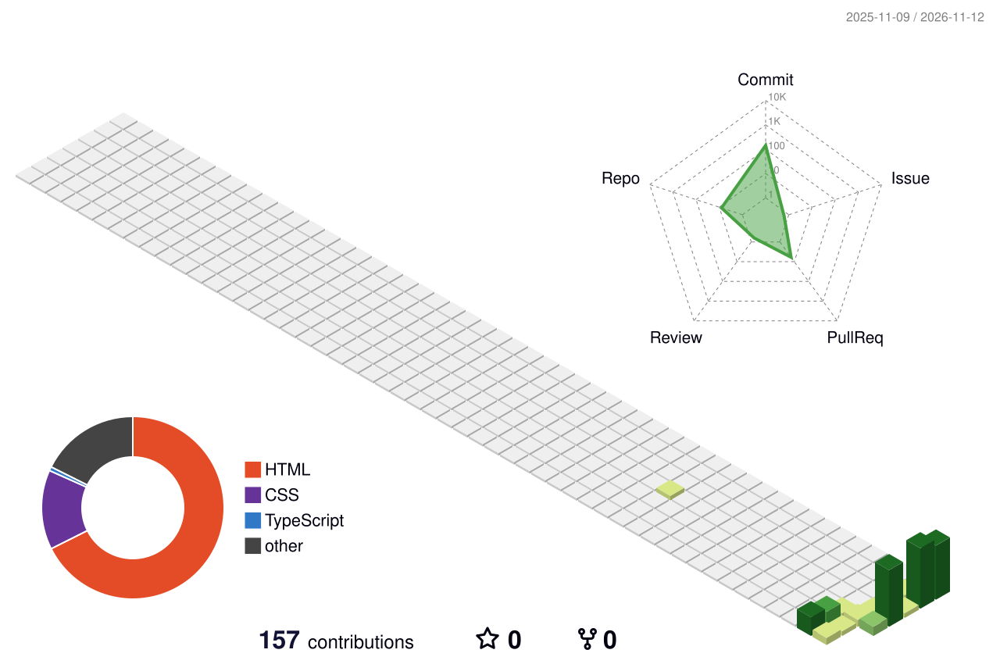
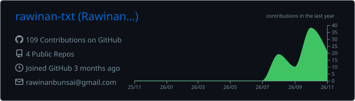
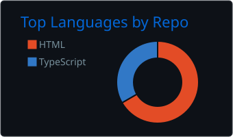
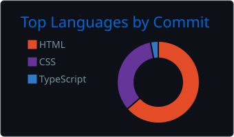
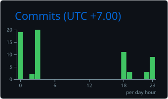
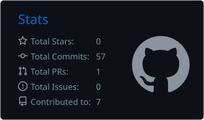

# Hi, I'm Rawinan 👋

### Building, learning, and turning ideas into software.

  

  
  
  
  

---

## `whoami`

I'm a **Year 2 Information and Communication Technology (ICT) student at Mahidol University**, interested in how software is designed, built, tested, and improved.

I'm exploring the intersection of **software development, Quality Assurance (QA), and Project Management (PM)**. I enjoy turning ideas into practical projects, understanding how systems work, and improving the experience for the people who use them.

- 🎓 Currently studying ICT at Mahidol University
- 🧪 Interested in software quality, testing, and finding ways to make products better
- 🧩 Exploring project planning, requirements, and product workflows
- 💻 Learning through hands-on projects and experimentation
- 🌱 Focused on building solid foundations in programming and databases

## `tech_stack`

*Tools and technologies I'm learning or working with.*

  

**Current focus:** JavaScript · Node.js · Express · SQL & Database Design · Git/GitHub

## `featured_projects`

A few projects and ideas I'm developing as I grow my skills.

<table>
  <tr>
    <td width="50%" valign="top">
      <h3>📚 Student Life Manager</h3>
      
A personal productivity web app for managing academic schedules, finances, study goals, and everyday student life.

      
<strong>Focus:</strong> UI/UX · Frontend · Practical Features

      <a href="https://github.com/rawinan-txt/student-life-manager">View Project →</a>
    </td>
    <td width="50%" valign="top">
      <h3>🏢 CondoFlow</h3>
      
A condominium management system focused on role-based workflows and the needs of owners, tenants, and administrators.

      
<strong>Focus:</strong> Requirements · System Design · Database · QA

      <a href="https://github.com/rawinan-txt?tab=repositories">Explore Project →</a>
    </td>
  </tr>

  <tr>
    <td width="50%" valign="top">
      <h3>🐲 Personal Portfolio</h3>
      
A personal portfolio showcasing my projects, technical skills, and learning journey as a second-year ICT student at Mahidol University, currently seeking internship opportunities.

      
<strong>Focus:</strong> Web Development · UI/UX · QA · Project Management

      <a href="https://github.com/rawinan-txt/Rawinan-portfolio2">View Project →</a>
    </td>
    <td width="50%" valign="top">
      <h3>🔍 More Experiments</h3>
      
Small experiments, coursework, and learning projects as I continue exploring software development and technology.

      
<strong>Focus:</strong> Continuous Learning · Problem Solving

      <a href="https://github.com/rawinan-txt?tab=repositories">Browse All Repositories →</a>
    </td>
  </tr>
</table>

## `github_analytics`

### 3D Contribution Calendar

<picture>
  <source media="(prefers-color-scheme: dark)" srcset="https://raw.githubusercontent.com/rawinan-txt/rawinan-txt/main/profile-3d-contrib/profile-night-rainbow.svg" />
  <source media="(prefers-color-scheme: light)" srcset="https://raw.githubusercontent.com/rawinan-txt/rawinan-txt/main/profile-3d-contrib/profile-season-animate.svg" />
  
</picture>

### Contribution Overview

<picture>
  <source media="(prefers-color-scheme: dark)" srcset="https://raw.githubusercontent.com/rawinan-txt/rawinan-txt/main/profile-summary-card-output/github_dark/0-profile-details.svg" />
  <source media="(prefers-color-scheme: light)" srcset="https://raw.githubusercontent.com/rawinan-txt/rawinan-txt/main/profile-summary-card-output/github_dark/0-profile-details.svg" />
  
</picture>

### Languages & Technology

<picture>
  <source media="(prefers-color-scheme: dark)" srcset="https://raw.githubusercontent.com/rawinan-txt/rawinan-txt/main/profile-summary-card-output/github_dark/1-repos-per-language.svg" />
  <source media="(prefers-color-scheme: light)" srcset="https://raw.githubusercontent.com/rawinan-txt/rawinan-txt/main/profile-summary-card-output/github_dark/1-repos-per-language.svg" />
  
</picture>
<picture>
  <source media="(prefers-color-scheme: dark)" srcset="https://raw.githubusercontent.com/rawinan-txt/rawinan-txt/main/profile-summary-card-output/github_dark/2-most-commit-language.svg" />
  <source media="(prefers-color-scheme: light)" srcset="https://raw.githubusercontent.com/rawinan-txt/rawinan-txt/main/profile-summary-card-output/github_dark/2-most-commit-language.svg" />
  
</picture>

### Developer Activity

<picture>
  <source media="(prefers-color-scheme: dark)" srcset="https://raw.githubusercontent.com/rawinan-txt/rawinan-txt/main/profile-summary-card-output/github_dark/4-productive-time.svg" />
  <source media="(prefers-color-scheme: light)" srcset="https://raw.githubusercontent.com/rawinan-txt/rawinan-txt/main/profile-summary-card-output/github_dark/4-productive-time.svg" />
  
</picture>
<picture>
  <source media="(prefers-color-scheme: dark)" srcset="https://raw.githubusercontent.com/rawinan-txt/rawinan-txt/main/profile-summary-card-output/github_dark/3-stats.svg" />
  <source media="(prefers-color-scheme: light)" srcset="https://raw.githubusercontent.com/rawinan-txt/rawinan-txt/main/profile-summary-card-output/github_dark/3-stats.svg" />
  
</picture>

## `pacman_eating_my_contributions`

  <picture>
    <source media="(prefers-color-scheme: dark)" srcset="https://raw.githubusercontent.com/rawinan-txt/rawinan-txt/output/pacman-contribution-graph-dark.svg" />
    <source media="(prefers-color-scheme: light)" srcset="https://raw.githubusercontent.com/rawinan-txt/rawinan-txt/output/pacman-contribution-graph.svg" />
    
  </picture>

## `currently_learning`

- Building backend foundations with Node.js and Express
- Practicing SQL, relational database design, and data organization
- Understanding software testing and QA fundamentals
- Learning how to plan features and structure projects

---

### Always learning. Always building. Always improving.

Thanks for stopping by! Feel free to explore my repositories.

