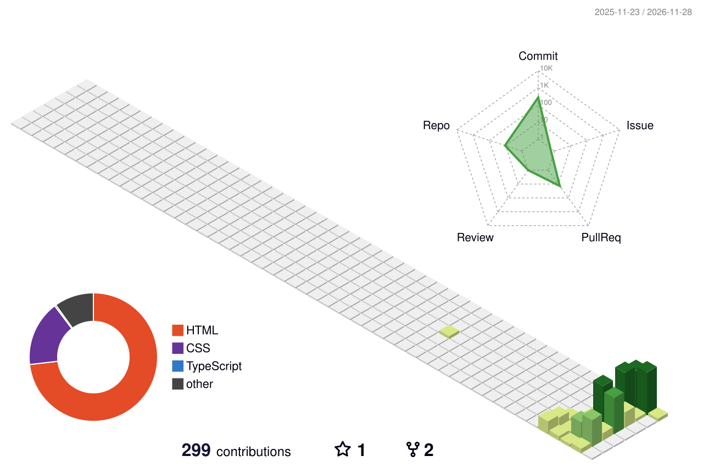
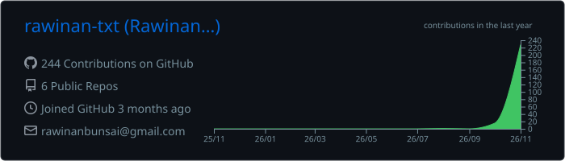
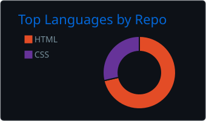
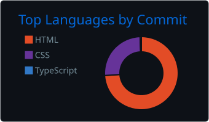
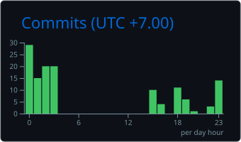
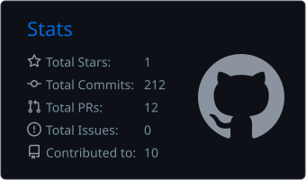

# Hi, I'm Rawinan

### Second-year ICT student at Mahidol University, looking for a QA internship

  

  
  
  
  

  
  

---

## `whoami`

I'm a second-year Information and Communication Technology student at Mahidol University. I design, build and test my own projects, and I use AI tools to work on software, data and business problems.

QA is my first choice for an internship. I'm also interested in business analysis, data analysis and systems analysis.

## `tech_stack`

  

| Area | What I use |
| --- | --- |
| Programming | Python, Java, JavaScript, HTML, CSS, SQL |
| Database | MySQL, ER/EER modelling, relational design, normalization (3NF) |
| Analysis | Business process analysis, business rules, applied statistics |
| Tools | Git, GitHub, VS Code, Figma, AI tools |

## `featured_projects`

<table>
  <tr>
    <td width="50%" valign="top">
      <h3>Student Life Manager</h3>
      Individual project
      
A web app for university students to manage their schedule, finances, study plans and GPA in one place. It runs in the browser and saves data locally.

      
<strong>Built with:</strong> HTML, CSS, JavaScript

      <a href="https://github.com/rawinan-txt/student-life-manager">Repository</a> &nbsp;·&nbsp; <a href="https://rawinan-txt.github.io/student-life-manager/">Live demo</a>
    </td>
    <td width="50%" valign="top">
      <h3>CondoFlow</h3>
      Team project of six · Database & Data Analytics Engineer
      
A clickable prototype of a condominium management system with four user roles. I worked on the data models, the reports and audit log, and the parcel module.

      
<strong>Built with:</strong> React, TypeScript, Vite, Recharts

      <a href="https://github.com/rawinan-txt/CondoFlow">Repository</a>
    </td>
  </tr>
  <tr>
    <td width="50%" valign="top">
      <h3>Starbucks Database Systems</h3>
      Team project of five · ITDS 221
      
A relational database design for beverage ordering, inventory and a rewards membership: business rules, ER/EER diagrams, a 3NF schema and a data dictionary.

      
<strong>Focus:</strong> Database design, business analysis

      <a href="https://github.com/rawinan-txt/Starbucks-Database-Systems">Repository</a>
    </td>
    <td width="50%" valign="top">
      <h3>Personal Portfolio</h3>
      Individual project
      
My portfolio site with project details, skills and contact links. Plain HTML, CSS and JavaScript, with light and dark themes.

      
<strong>Built with:</strong> HTML, CSS, JavaScript

      <a href="https://github.com/rawinan-txt/Rawinan-portfolio2">Repository</a> &nbsp;·&nbsp; <a href="https://rawinan-txt.github.io/Rawinan-portfolio2/">Visit site</a>
    </td>
  </tr>
</table>

## `currently_learning`

- Software testing: writing test cases and bug reports for my own projects
- SQL and relational database design
- Backend basics with Node.js and Express

## `github_analytics`

<picture>
  <source media="(prefers-color-scheme: dark)" srcset="https://raw.githubusercontent.com/rawinan-txt/rawinan-txt/main/profile-3d-contrib/profile-night-rainbow.svg" />
  <source media="(prefers-color-scheme: light)" srcset="https://raw.githubusercontent.com/rawinan-txt/rawinan-txt/main/profile-3d-contrib/profile-season-animate.svg" />
  
</picture>

<picture>
  <source media="(prefers-color-scheme: dark)" srcset="https://raw.githubusercontent.com/rawinan-txt/rawinan-txt/output/pacman-contribution-graph-dark.svg" />
  <source media="(prefers-color-scheme: light)" srcset="https://raw.githubusercontent.com/rawinan-txt/rawinan-txt/output/pacman-contribution-graph.svg" />
  
</picture>

